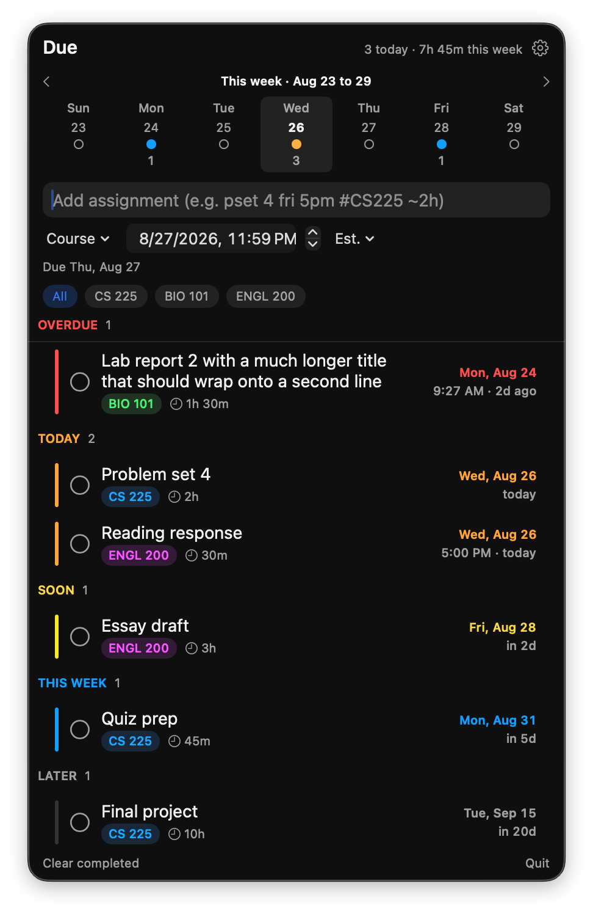
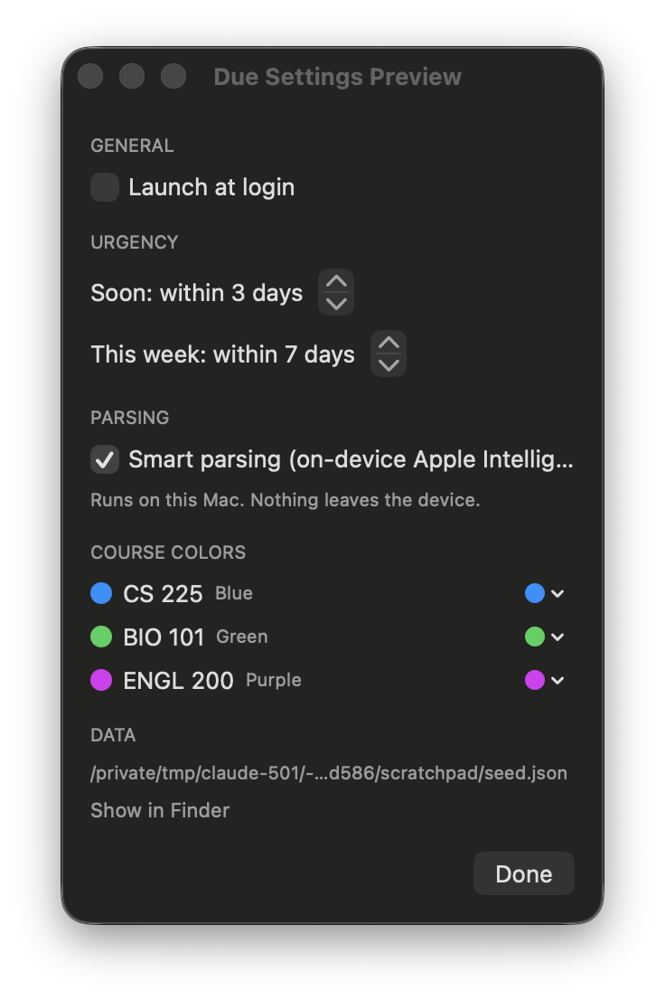

# Due

A macOS menu bar assignment tracker with an AI notes window. Lives in the menu bar
(no Dock icon), shows how many things are due today, and lets you add and manage
assignments from a small popover. A separate Notes window handles class notes:
autosaving editor, lecture recording with live on-device transcription, and on-device
AI cleanup. Nothing leaves your Mac; there is no network layer at all.



## Install

Requirements: macOS 14 or newer and the Swift toolchain (Xcode, or the Command Line
Tools with Xcode 16+ / Swift 6). Smart parsing and the notes AI actions additionally
need macOS 26 with Apple Intelligence turned on, and lecture transcription wants Apple
silicon (the model runs on the Neural Engine); everything else works without them.

```
git clone https://github.com/sammg123/due.git
cd due
./build.sh
```

That builds a release binary, assembles `~/Applications/Due.app`, signs it locally, and
launches it. A checklist icon appears in the menu bar. Because the app is built and signed
on your own Mac, there is no Gatekeeper download warning. Rebuild any time with the same
command; `./build.sh --test` runs the unit tests first and `./build.sh --no-launch` skips
opening the app.

To start it automatically, open the gear menu in the popover and turn on Launch at login.

Your data is one JSON file at `~/Library/Application Support/Due/assignments.json`. Back it
up by copying that file. Nothing is sent anywhere; the app has no network code.

## Quick add

Type a line like this and press Enter:

```
pset 4 fri 5pm #CS225 ~1h30m
```

That parses to: title "pset 4", due next Friday at 5:00 PM, course CS225, estimate 1
hour 30 minutes. Anything you don't type is left out; a bare title with no date uses the date
picker next to the field (tomorrow, 11:59 PM by default).

**Dates**

| You type | Means |
|---|---|
| `today`, `tonight`, `tod`, `eod` | today |
| `tomorrow`, `tmr`, `tmrw`, `tmw` | tomorrow |
| `mon` … `sunday` | the next occurrence of that weekday |
| `next fri` | that weekday, but in the following week |
| `in 3 days`, `in 2 weeks` | relative offset |
| `eow` | end of this week (Friday) |
| `dec 8`, `december 8th` | that date, next occurrence (rolls to next year if passed) |
| `12/8` | month/day, same rollover rule |

**Times**

| You type | Means |
|---|---|
| `5pm`, `5:30pm`, `17:00, at 1230, 830am` | that clock time |
| `at 5`, `@ 5` | 5 reads as PM if 1 to 6, AM if 7 to 11 |
| `noon` | 12:00 PM |
| `midnight` | 11:59 PM (end of that day) |

No time given = 11:59 PM on the due date.

**Other tokens**

| You type | Means |
|---|---|
| `#CS225` | course tag |
| `~1h30m`, `~45m`, `~2h`, `~1.5 hours` | estimated time |

## Color legend

Course colors are cosmetic and assigned automatically; urgency colors are fixed and
mean the same thing everywhere in the app:

| Color | Bucket |
|---|---|
| Red | Overdue |
| Orange | Due today |
| Yellow | Soon (inside your "soon" threshold) |
| Blue | This week (inside your "this week" threshold) |
| Gray | Later |

Both thresholds are adjustable in Settings.

## Keyboard shortcuts

| Shortcut | Action |
|---|---|
| Enter | Add the quick-add line |
| Cmd+N | Focus the quick-add field |
| Shift+Cmd+N | Open the Notes window |
| Cmd+N (in Notes) | New note |
| Esc | Close the popover |
| Cmd+Q | Quit Due |

## Where data lives

Everything is a single JSON file at:

```
~/Library/Application Support/Due/assignments.json
```

Settings > Data has a "Show in Finder" button that jumps straight to it. There is no
sync, no account, and no telemetry; back up that one file if you want a backup.

## Building

```
./build.sh
```

Builds a release binary, assembles `~/Applications/Due.app`, code-signs it, and
relaunches it if it's already running. Flags:

- `--test` runs `swift test` first and stops if anything fails.
- `--no-launch` skips opening the app after building.

Requires macOS 14 or later.

## Launch at login

Settings > General > "Launch at login". This only works once Due is running from
`~/Applications/Due.app` (built via `./build.sh`); it can't register a login item when
run straight out of `.build/debug`.

## Views and filters

- Week strip: click a day to see only what is due that day, click the week title for the whole week, and use the arrows to page to next weeks (or up to 4 weeks back). "All" in the scope bar returns to the full list.
- Course chips under the add field filter everything (list and week strip) to one course.
- Right-click a group header for "Sort by due date" or "Sort by course". Drag rows to set your own order.

## Notes

Open with the note icon in the popover header (or Shift+Cmd+N from the popover). Notes
are per-class documents that autosave as you type (debounced under a second, plus on
window close and quit), searchable, and sortable by class, date edited, or name from
the toolbar. Classes share the exact course tags and colors from the assignment list.

**Lecture capture.** The mic button records the room and transcribes it live on the
Neural Engine using NVIDIA Parakeet v3 (via FluidAudio, the same model LocalFlow
uses; the ~500 MB download happens once and is shared between the two apps).
Transcript chunks land in the note under a timestamped "Lecture" heading roughly
every 30 seconds, cut at pauses so words don't get split. The audio itself is kept as
an .m4a next to your notes (toggle in Settings under Lecture capture) and can be
reopened from the recordings menu in the editor header. Recording survives closing
the notes window; a red pill in the popover header shows it's still running.

**AI actions.** With Apple Intelligence enabled (macOS 26), the sparkles menu offers
Clean up writing, Summarize (adds a summary section on top), and Turn into outline.
Long transcripts are processed in chunks. Every AI edit gets a one-click "Revert AI
edit" in the status bar. On-device, like everything else.

Notes are one JSON file each under `~/Library/Application Support/Due/Notes/`, with
recordings in `Notes/Audio/`.

## Smart parsing

With Apple Intelligence enabled (macOS 26), the add field also runs an on-device language model about half a second after you stop typing. It cleans up the title, maps loose class mentions ("for writing") onto your real course names, and reads durations. A sparkles icon in the preview line means the model's read is in use. Dates the built-in parser recognizes always win, because the model is not reliable at weekday arithmetic ("next fri"). Turn it off in Settings under Parsing. Nothing leaves the Mac.

## Development

```
swift test            # 211 unit tests on the DueCore logic
swift build
.build/debug/Due --preview            # popover in a normal window, for screenshots
.build/debug/Due --preview-settings   # settings pane in a window
.build/debug/Due --notes              # straight into the notes window
```

`DUE_DATA_PATH=/path/to/file.json` points the app at a different data file and
`DUE_NOTES_PATH=/path/to/dir` at a different notes directory. `DUE_DEBUG=1`
enables two dev signals: `kill -USR1 <pid>` clicks the menu bar item, `kill -USR2 <pid>`
sends Escape, which lets a script drive the real popover without Accessibility access.



## License

MIT
